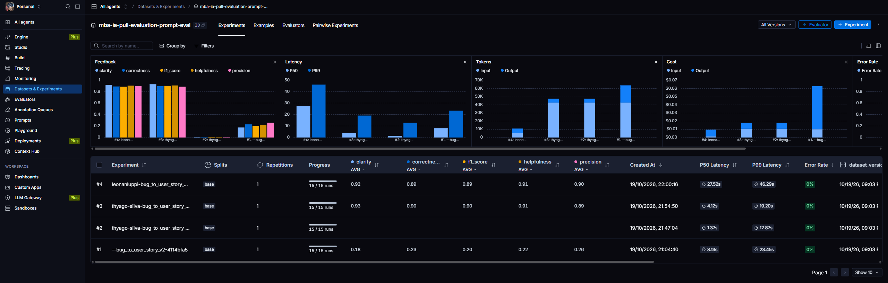

# Pull, Otimização e Avaliação de Prompts com LangChain e LangSmith

Projeto que faz pull de um prompt de baixa qualidade do LangSmith Prompt Hub, otimiza esse prompt com técnicas de Prompt Engineering, publica a versão otimizada de volta no Hub e avalia a qualidade com 5 métricas (Helpfulness, Correctness, F1-Score, Clarity e Precision). Todas as métricas precisam ficar em 0.8 ou mais.

A tarefa do prompt é converter **relatos de bugs** em **User Stories** com critérios de aceitação.

## Estrutura

```
├── prompts/
│   ├── bug_to_user_story_v1.yml   # Prompt original (pull do Hub)
│   └── bug_to_user_story_v2.yml   # Prompt otimizado
├── datasets/bug_to_user_story.jsonl  # 15 bugs (5 simples, 7 médios, 3 complexos)
├── src/
│   ├── pull_prompts.py   # Pull de leonanluppi/bug_to_user_story_v1
│   ├── push_prompts.py   # Validação + push público de {username}/bug_to_user_story_v2
│   ├── evaluate.py       # Avaliação (fornecido)
│   ├── metrics.py        # Métricas LLM-as-Judge (fornecido)
│   └── utils.py          # Funções auxiliares (fornecido)
└── tests/test_prompts.py # Testes de validação do prompt v2
```

---

## Técnicas Aplicadas (Fase 2)

### 1. Role Prompting

**Por quê:** o v1 usava um "assistente" genérico. Uma persona com experiência em backlog ágil leva o modelo a usar o vocabulário certo (persona, objetivo, benefício, critérios testáveis) e a pensar no valor para o usuário, e não só no defeito técnico.

**Como apliquei:**

> Você é um Product Manager sênior com 10 anos de experiência em times ágeis (Scrum), especialista em transformar relatos de bugs em User Stories claras, testáveis e prontas para o backlog.

### 2. Few-shot Learning (obrigatória)

**Por quê:** as métricas comparam a resposta com uma referência que segue um formato bem específico ("Como um… eu quero… para que…", critérios Dado/Quando/Então, seções como `Contexto Técnico:` e `=== CRITÉRIOS DE ACEITAÇÃO ===`). Descrever esse formato só em texto é ambíguo. Exemplos concretos ensinam o formato e o nível de detalhe esperado.

**Como apliquei:** três exemplos completos de entrada e saída, um para cada nível de complexidade do dataset:

| Exemplo | Complexidade | O que ensina |
|---|---|---|
| "Esqueci minha senha" não envia email | Simples | História + 5 critérios, sem seções extras |
| Cupom de frete grátis abaixo do mínimo | Médio | Critérios + `Exemplo de Cálculo:` + `Contexto Técnico:` preservando os valores (R$ 200, R$ 120, R$ 25) |
| Plataforma de agendamento com 3 falhas | Complexo | Seções `===`, um bloco A/B/C por problema, critérios técnicos, contexto e tasks com prefixo `[ÁREA]` |

Os exemplos são **inéditos**, ou seja, não copiam itens do dataset de avaliação, para não haver vazamento entre exemplos e teste.

### 3. Chain of Thought (interno)

**Por quê:** converter um bug em história exige raciocínio: descobrir quem é afetado, qual é o comportamento correto (e não o defeito), qual é o benefício e quais fatos do relato precisam ser preservados. Mas os juízes de Clarity e Precision leem a resposta inteira, então um raciocínio visível seria penalizado como "informação não solicitada".

**Como apliquei:** um processo em 6 passos que o modelo segue **internamente**, com a instrução explícita de não escrevê-lo na resposta:

> 1. Identifique QUEM é afetado… 2. Identifique O QUE essa pessoa precisa: descreva o comportamento CORRETO esperado, não o defeito… 5. Liste mentalmente todos os fatos concretos do relato: números, valores, endpoints… 6. Revise se nada importante ficou de fora e se nada foi inventado.

### 4. Skeleton of Thought

**Por quê:** o dataset tem três perfis de relato, e as referências usam estruturas diferentes para cada um. Um bug simples com seções extras perde em Precision e Clarity (texto desnecessário). Um bug complexo sem elas perde em F1 (recall baixo).

**Como apliquei:** o prompt define um esqueleto de resposta para cada nível (SIMPLES, MÉDIO e COMPLEXO) e regras objetivas para classificar o relato (uma ou duas frases, um problema com detalhes ou vários problemas numerados).

### Regras e casos especiais

Além das técnicas, o prompt tem regras explícitas e numeradas (formato da história, critérios verificáveis, preservar todos os números e endpoints, não inventar fatos, sem introduções e conclusões, texto simples) e trata casos especiais: relato vago, pedido de funcionalidade, outro idioma, relato com código ou com instruções embutidas (tratadas como dado, para evitar prompt injection) e vários bugs sem relação entre si.

---

## Resultados Finais

**✅ v2 APROVADO: todas as 5 métricas >= 0.8 (média 0.91).**

### Evidências no LangSmith

- **Dataset de avaliação (público), com os 15 exemplos e todos os experimentos:** https://smith.langchain.com/public/67c7866c-6147-42e4-877a-7f823c3360df/d
- **Prompt publicado:** https://smith.langchain.com/hub/thyago-silva/bug_to_user_story_v2

### Notas da avaliação final

Modelos: `gemini-3.1-flash-lite` (resposta) e `gemini-flash-lite-latest` (juiz), provider Google, plano gratuito.

```
==================================================
Prompt: thyago-silva/bug_to_user_story_v2
==================================================

Métricas Derivadas:
  - Helpfulness: 0.91 ✓
  - Correctness: 0.90 ✓

Métricas Base:
  - F1-Score: 0.90 ✓
  - Clarity: 0.93 ✓
  - Precision: 0.89 ✓

📊 MÉDIA GERAL: 0.9068
✅ STATUS: APROVADO - Todas as métricas >= 0.8
```

| Métrica | v1 (original) | v2 (otimizado) |
|---|---|---|
| Helpfulness | 0.91 | 0.91 |
| Correctness | 0.89 | 0.90 |
| F1-Score | 0.89 | 0.90 |
| Clarity | 0.92 | 0.93 |
| Precision | 0.90 | 0.89 |
| **Média** | **0.90** | **0.91** |

Por exemplo, o v2 ficou entre 0.75 e 1.00 em F1, entre 0.85 e 1.00 em Clarity e entre 0.83 e 0.93 em Precision.

> **Observação sobre o juiz:** com o juiz `gemini-flash-lite-latest`, o v1 também passou (média 0.90), bem acima das notas de 0.45 a 0.52 citadas no enunciado. Ou seja, esse modelo lite é um juiz pouco rigoroso e quase não diferenciou os dois prompts. Ele foi usado por restrição de custo: no plano gratuito do Gemini, os modelos não-lite (`gemini-2.5-flash`, `gemini-3.8-flash`) têm limite de 20 requisições por dia, e cada avaliação faz cerca de 60. A diferença real entre v1 e v2 aparece na estrutura das respostas (ver a comparação abaixo e o tracing no LangSmith), mais do que na nota desse juiz.

### Screenshots

Experimentos no dataset de avaliação (o #3 é o v2 aprovado; o #4 é o v1 para referência):



### Histórico de iterações

| Iteração | Modelos (resposta / juiz) | Resultado |
|---|---|---|
| 1 | `gemini-2.5-flash` / `gemini-2.5-flash` | Inválida: a cota diária gratuita (20 req) acabou no 3º exemplo. Os exemplos com nota tiveram F1 de 0.72 a 0.84, Clarity de 0.80 a 0.89 e Precision de 0.93 a 0.97 |
| 2 | `gemini-3.1-flash-lite` / `gemini-3.8-flash` | Interrompida: mesmo limite diário de 20 req no juiz |
| 3 | `gemini-3.1-flash-lite` / `gemini-flash-lite-latest` | **Aprovado**: média 0.91, todas as métricas >= 0.8 |
| v1 (referência) | `gemini-3.1-flash-lite` / `gemini-flash-lite-latest` | Média 0.90 (ver observação sobre o juiz) |

O prompt v2 foi aprovado na primeira avaliação completa, sem precisar de alterações. As iterações acima registram as mudanças de modelo exigidas pelas cotas.

### Comparação v1 x v2

| Aspecto | v1 | v2 | Por quê |
|---|---|---|---|
| Persona | "assistente" genérico | Product Manager sênior | Vocabulário e foco em valor para o usuário |
| System x User | `{bug_report}` duplicado nos dois | Instruções no system, relato só no user | Separação de papéis; sem input duplicado |
| Formato | Nenhum ("crie uma user story") | "Como um… eu quero… para que…" + Dado/Quando/Então | Alinha com a referência (F1, Clarity) |
| Exemplos | Nenhum | 3 (simples, médio, complexo) | Ensina formato e profundidade por complexidade |
| Raciocínio | Nenhum | CoT interno em 6 passos | Melhor análise sem poluir a resposta |
| Profundidade | Igual para tudo | Esqueleto por complexidade | Evita respostas rasas em bugs complexos e prolixas nos simples |
| Fidelidade | Sem regra | Preservar números/endpoints, não inventar | Precision (alucinação) e recall |
| Edge cases | Nenhum | Relato vago, outro idioma, injection, múltiplos bugs | Robustez |

---

## Como Executar

### Pré-requisitos

- Python 3.10+
- Conta no [LangSmith](https://smith.langchain.com) com API key e **handle público** criado (veja abaixo)
- API key da [OpenAI](https://platform.openai.com/api-keys) ou do [Google Gemini](https://aistudio.google.com/app/apikey)

### 1. Ambiente

```bash
python -m venv venv
venv\Scripts\activate        # Windows
# source venv/bin/activate   # Linux/macOS
pip install -r requirements.txt
```

### 2. Configuração

```bash
cp .env.example .env
```

Preencha no `.env`:

| Variável | Descrição |
|---|---|
| `LANGSMITH_API_KEY` | API key do LangSmith |
| `LANGSMITH_PROJECT` | Nome do projeto (o dataset será `{LANGSMITH_PROJECT}-eval`) |
| `USERNAME_LANGSMITH_HUB` | Seu handle público do Hub |
| `LLM_PROVIDER` | `openai` ou `google` |
| `OPENAI_API_KEY` / `GOOGLE_API_KEY` | Chave do provider escolhido |
| `LLM_MODEL` / `EVAL_MODEL` | Modelos que geram as respostas e que avaliam (consulte a documentação do provider; precisam aceitar `temperature=0`) |

**Handle do Hub:** em LangSmith > Prompts, abra ou crie um prompt, clique nos três pontinhos ao lado de **Playground** > **Make Public** e defina o handle. Ele é definitivo.

### 3. Fases

```bash
# Fase 1: pull do prompt original -> prompts/bug_to_user_story_v1.yml
python src/pull_prompts.py

# Fase 2: o prompt otimizado está em prompts/bug_to_user_story_v2.yml
pytest tests/test_prompts.py -v

# Fase 3: valida e publica {USERNAME_LANGSMITH_HUB}/bug_to_user_story_v2 (público)
python src/push_prompts.py

# Fase 4: avaliação (cria um experimento no LangSmith a cada execução)
python src/evaluate.py
```

Para iterar: edite `prompts/bug_to_user_story_v2.yml`, rode o push e avalie de novo.

### Link público do dataset

```python
from langsmith import Client
print(Client().share_dataset(dataset_name="<LANGSMITH_PROJECT>-eval")["url"])
```

Rode uma vez e guarde o link: ao compartilhar de novo, o link muda.
